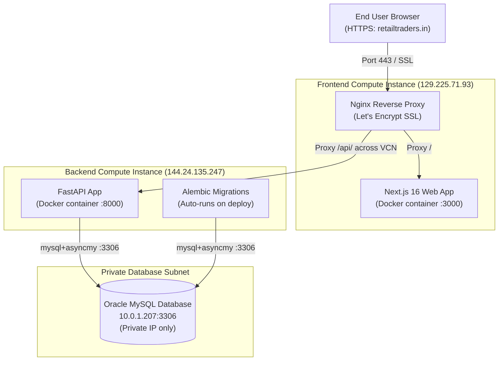

# Production Deployment Runbook — NetPnL (retailtraders.in)

> **Live Production URL**: [https://retailtraders.in](https://retailtraders.in)  
> **Repository**: [git@github.com:Gangadhar454/retailtraders.git](https://github.com/Gangadhar454/retailtraders) (`main` branch)  
> **Cloud Provider**: Oracle Cloud Infrastructure (OCI Free Tier)

---

## 1. Architecture Overview



---

## 2. Server Inventory, Credentials & SSH Keys

All SSH keys are stored on the local developer machine under `C:\Users\HARITHA\Documents\netpl-keys\`.

| Component | Public IP | Private IP (VCN) | OS / User | Local SSH Key Location | Remote Path |
| :--- | :--- | :--- | :--- | :--- | :--- |
| **Frontend VM** | `129.225.71.93` | `10.0.0.x` | Ubuntu 22.04 (`ubuntu`) | `C:\Users\HARITHA\Documents\netpl-keys\frontend\frontend.key` | `/opt/netpnl` |
| **Backend VM** | `144.24.135.247` | `10.0.0.129` | Ubuntu 22.04 (`ubuntu`) | `C:\Users\HARITHA\Documents\netpl-keys\backend\backend.key` | `/opt/netpnl` |
| **MySQL DB** | *None (Private)* | `10.0.1.207` | Oracle MySQL 8.x | Key backup in `...\netpl-keys\database\` | Port `3306` |

### Database Credentials (Configured in `/opt/netpnl/infra/backend/.env` on Backend VM)
- **Host**: `10.0.1.207`
- **Port**: `3306`
- **Database**: `netpnl`
- **User**: `netpnl_app`
- **Driver**: `mysql+asyncmy`

---

## 3. Strict Safety & Isolation Rules

1. **Local-Only Scripts**:
   - `backend/scripts/seed_500_today.py` is in `.gitignore`.
   - **NEVER** push seed scripts or run mock bulk data generators against production MySQL.
   - Any local test data stays in local SQLite (`backend/netpnl.db`).
2. **Password Security**:
   - Production passwords use **Bcrypt (12 rounds) + SHA-256 pre-hashing** (`backend/app/core/security.py`).
   - Plaintext passwords are never stored in logs or the database.
3. **Domain & SSL**:
   - Domain is strictly `retailtraders.in`.
   - Nginx handles automated HTTP -> HTTPS redirect (301) and HSTS.

---

## 4. Standard Step-by-Step Deployment Procedure

### Step 1: Pre-Deployment Verification & Git Push (Local Machine)

From your local project root (`C:\Users\HARITHA\Documents\Default Project`):

```powershell
# 1. Verify TypeScript & Next.js production build locally
cd frontend
npm.cmd run build
cd ..

# 2. Stage and commit changes (seed_500_today.py is automatically ignored)
git add .
git commit -m "feat/fix: <clear summary of your changes>"

# 3. Push to GitHub main branch
git push origin main
```

---

### Step 2: Deploy to Backend VM

Run directly from local PowerShell:

```powershell
ssh -i "C:\Users\HARITHA\Documents\netpl-keys\backend\backend.key" -o StrictHostKeyChecking=no ubuntu@144.24.135.247 "cd /opt/netpnl && git pull origin main && cd infra/backend && docker compose -f docker-compose.prod.yml up -d --build"
```

#### Verification:
```powershell
ssh -i "C:\Users\HARITHA\Documents\netpl-keys\backend\backend.key" -o StrictHostKeyChecking=no ubuntu@144.24.135.247 "curl -fsS http://127.0.0.1:8000/health"
```
**Expected Output**:
```json
{"status":"ok","database":"up","environment":"production"}
```

---

### Step 3: Deploy to Frontend VM

> [!IMPORTANT]
> **Micro VM Memory Constraint**: The Frontend VM has **1 GB RAM**.  
> If Docker tries to build Next.js while the existing container is running, the compiler will exhaust memory and crash.  
> You must **stop the container first (`down`)**, set `NEXT_CPU_COUNT=1`, and limit Node memory to 1024 MB.
>
> **PowerShell Quote Escaping**: Use **single quotes** (`'...'`) in PowerShell and omit inner quotes around `NODE_OPTIONS=--max-old-space-size=1024` to prevent PowerShell from stripping quotes.

#### Method A: Direct from Local PowerShell (Recommended)
```powershell
ssh -i "C:\Users\HARITHA\Documents\netpl-keys\frontend\frontend.key" -o StrictHostKeyChecking=no ubuntu@129.225.71.93 'cd /opt/netpnl/infra/frontend && docker compose -f docker-compose.prod.yml down && NEXT_CPU_COUNT=1 NODE_OPTIONS=--max-old-space-size=1024 docker compose -f docker-compose.prod.yml build && docker compose -f docker-compose.prod.yml up -d'
```

#### Method B: Interactive inside SSH (To view live build logs)
```powershell
# Connect
ssh -i "C:\Users\HARITHA\Documents\netpl-keys\frontend\frontend.key" ubuntu@129.225.71.93

# Run inside ubuntu@netpl-frontend:~$
cd /opt/netpnl/infra/frontend
docker compose -f docker-compose.prod.yml down
NEXT_CPU_COUNT=1 NODE_OPTIONS="--max-old-space-size=1024" docker compose -f docker-compose.prod.yml build
docker compose -f docker-compose.prod.yml up -d
```

---

## 5. Production Health Verification

After deployment, test all endpoints from your local terminal:

```powershell
python -c "
import urllib.request
endpoints = [
    'https://retailtraders.in/',
    'https://retailtraders.in/leaderboard',
    'https://retailtraders.in/terms',
    'https://retailtraders.in/privacy',
    'https://retailtraders.in/disclaimer',
    'https://retailtraders.in/api/v1/leaderboard/sentiment'
]
for ep in endpoints:
    try:
        r = urllib.request.urlopen(ep, timeout=10)
        print(f'{ep:55} -> {r.status} OK')
    except Exception as e:
        print(f'{ep:55} -> ERROR: {e}')
"
```

All routes must return `200 OK`.

---

## 6. Common Operations & Troubleshooting

### Check Frontend Container Status & Logs
```powershell
ssh -i "C:\Users\HARITHA\Documents\netpl-keys\frontend\frontend.key" ubuntu@129.225.71.93 "docker ps && docker logs --tail 30 netpnl-frontend-frontend-1"
```

### Check Backend Container Status & Logs
```powershell
ssh -i "C:\Users\HARITHA\Documents\netpl-keys\backend\backend.key" ubuntu@144.24.135.247 "docker ps && docker logs --tail 30 netpnl-backend-api-1"
```

### Restart Nginx on Frontend VM
```powershell
ssh -i "C:\Users\HARITHA\Documents\netpl-keys\frontend\frontend.key" ubuntu@129.225.71.93 "sudo nginx -t && sudo systemctl restart nginx"
```

### SSL Certificate Renewal (Let's Encrypt)
Certbot renews automatically via systemd timer. To test dry-run:
```powershell
ssh -i "C:\Users\HARITHA\Documents\netpl-keys\frontend\frontend.key" ubuntu@129.225.71.93 "sudo certbot renew --dry-run"
```

### Swap Memory Status (Both VMs have 2 GB Swap configured)
```powershell
ssh -i "C:\Users\HARITHA\Documents\netpl-keys\frontend\frontend.key" ubuntu@129.225.71.93 "free -h"
ssh -i "C:\Users\HARITHA\Documents\netpl-keys\backend\backend.key" ubuntu@144.24.135.247 "free -h"
```

